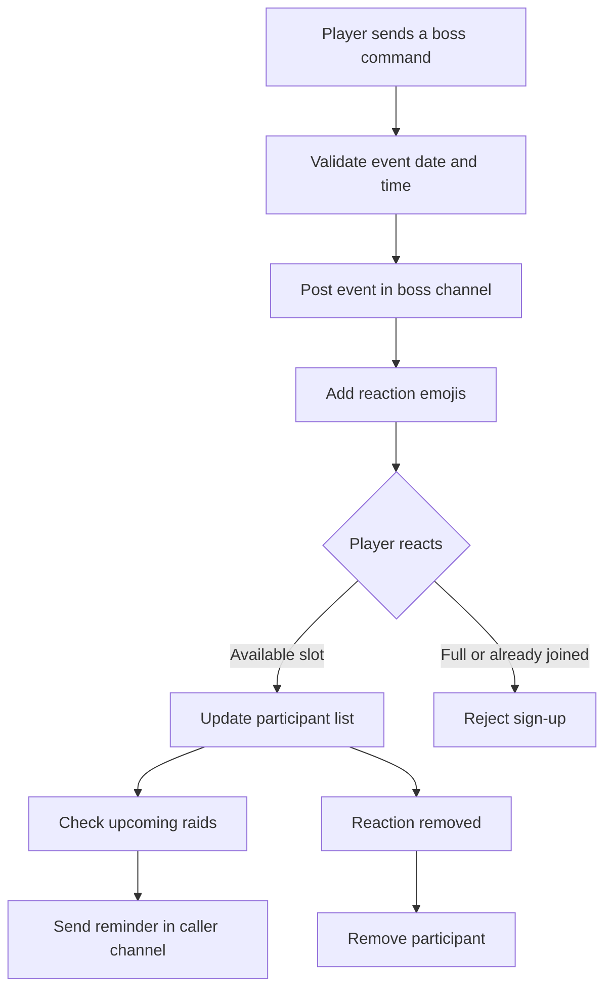

# Discord Boss Bot

**A Python Discord bot for organizing boss raids with reaction-based sign-ups.**

Discord Boss Bot was built to make scheduling group boss fights easier on a Discord server. Instead of collecting names in chat, players can create a timed event, join it using an emoji reaction, and see who has signed up. The bot also provides event listings and sends reminders before raids.

## Features

| Feature | What it does |
| --- | --- |
| Raid scheduling | Creates boss events for a specified date and time |
| Reaction sign-ups | Lets players join a raid by reacting to its message |
| Limited party size | Creates a fixed number of slots for each configured boss |
| Leave an event | Removes a player from the roster when they remove their reaction |
| Duplicate protection | Rejects attempts to join the same event twice |
| Event overview | Lists today's events, upcoming events, and a player's own events |
| Raid reminders | Posts a reminder in a designated channel shortly before a raid |
| Server configuration | Maps bosses to Discord roles, channels, and party sizes |
| Channel cleanup | Periodically purges bot response and reminder channels |

## How it works



### Example raid

Create an event in the bot command channel:

```text
!boss1 15.12.2026-20:30
```

The bot posts an event in the channel configured for `boss1`, mentions its role, records the creator, and adds numbered participant slots:

```text
@boss1 15.12.2026-20:30 by @player
1:
2:
3:
```

Players join using one of the configured emoji reactions. The bot updates the corresponding slot with their mention and chosen emoji. Removing the reaction removes their entry.

## Commands

| Command | Description |
| --- | --- |
| `!help` | Show help and available bosses |
| `!bossList` | List configured boss commands |
| `!today` | Show events scheduled for today |
| `!eventList` | Show active and upcoming events |
| `!show` | Show upcoming events the requesting user has joined |
| `!<boss> DD.MM.YYYY-HH:MM` | Schedule a raid for the selected boss |

Dates use the server's local system time and must be in the future. The command prefix is configurable (default: `!`).

## Project structure

```text
.
├── main.py              # Discord client, events, and background tasks
├── globals.py           # Bot settings, channels, roles, bosses, and emoji
├── messageValidator.py  # Date, time, and command validation
├── messageFormater.py   # Raid message formatting and roster updates
├── InfoMessages.py      # Help text, event lists, and error messages
├── emojiChecker.py      # Reaction validation and counting
├── mention.py           # Discord mention helpers
└── messageHolding.py    # In-memory event tracking lists
```

## Configuration

The original code keeps configuration in `globals.py`:

- `BOT_NAME` — bot account name used by reaction handling.
- `START_COMMAND_PREFIX` — command prefix.
- `CHANNEL_BOT_ANSWER` — channel for commands, help, and error messages.
- `CHANNEL_BOT_CALLER` — channel for raid reminders.
- `BOSSES_MAP` — number of player slots for each boss.
- `MENTION_MAP` — boss names mapped to Discord role IDs.
- `BOSS_CH_ID` — boss names mapped to event channel IDs.
- `EMOJI_MAP` — custom server emoji used for sign-ups.
- `INTERVAL_TIME`, `MINIMUM_INTERVAL_TIME`, `MINIMUM_MEMBER_TO_CALL` — reminder thresholds.

For each boss, use the same key in `BOSSES_MAP`, `MENTION_MAP`, and `BOSS_CH_ID`. Configure valid role, channel, and custom emoji IDs for your server.

## Running the project

This repository contains a **legacy `discord.py` implementation**. Its event loop initialization and reaction handling were written against older library behavior; it is **not verified to work with current `discord.py` releases without changes**.

1. Create a Discord application and bot in the [Discord Developer Portal](https://discord.com/developers/applications).
2. Invite the bot to your server with the permissions needed to read and send messages, manage reactions, edit its own messages, and manage messages for the configured cleanup behavior.
3. Configure the channel IDs, role IDs, boss definitions, and emoji in `globals.py`.
4. Install a compatible version of `discord.py` for the original code, or update the code to the current API.
5. **Replace the hard-coded token in `main.py` with a secure environment-variable lookup** before running the bot:

   ```python
   import os
   client.run(os.environ["DISCORD_BOT_TOKEN"])
   ```

6. Set `DISCORD_BOT_TOKEN` in your environment and run:

   ```bash
   python main.py
   ```

The repository does not include a dependency lockfile or a tested modern setup, so these are migration-oriented instructions rather than a guarantee of immediate compatibility.

## Implementation notes

The bot uses asynchronous Discord event handlers (`on_message`, `on_reaction_add`, `on_raw_reaction_remove`, and `on_raw_message_delete`) alongside background loops that check upcoming raids, refresh tracked messages, post reminders, and clean channels.

Event tracking is held in Python lists in memory; there is no database or durable event restoration after a restart. Some timing, duplicate-checking, and reaction-counting logic is also tied to assumptions about the original server setup. The implementation is best viewed as a working concept from an earlier version of the Discord API, rather than a maintained production bot.

## Author

**Damian Panasiuk** — [GitHub](https://github.com/GHRik)
