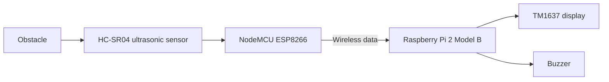

# DIY Wireless Parking Sensor

**A Raspberry Pi + ESP8266 parking assistance project (2018)**

A small DIY parking sensor built around a simple idea: keep wiring between the distance sensor and the driver-facing display to a minimum. An ultrasonic sensor measures the distance to an obstacle, while a separate Raspberry Pi-based unit provides visual and audible feedback.

Built in **2018**, this project explores a simple wireless architecture for a DIY parking assistant. The sensing and feedback units are separate, so they do not need a long signal cable between them.

## Hardware

| Component | Role |
| --- | --- |
| NodeMCU (ESP8266) | Sensor-side microcontroller and wireless communication |
| HC-SR04 | Ultrasonic distance measurement |
| Raspberry Pi 2 Model B | Display-side processing |
| TM1637 four-digit display | Distance readout |
| Buzzer | Audible proximity indication |
| Arduino Mega 2560 | Power supply in the original prototype setup |

## How it works

The prototype separates distance sensing from user feedback. The NodeMCU reads the ultrasonic sensor and communicates the measurements to the Raspberry Pi. The Raspberry Pi drives the numeric display and buzzer.

*The diagram above is a functional overview, not a pin-level wiring diagram.*

## Original circuit diagram

[`circuit.PNG`](circuit.PNG) to view it at full resolution.

## Source code

The original implementation is preserved in the two source directories:

- [`nodeMCU/`](nodeMCU/) — ESP8266 firmware and sensor-side logic.
- [`Raspberry PI/`](Raspberry%20PI/) — Raspberry Pi-side application.

The project uses **C++ and Python**. See the source files for the exact pin assignments, message format, dependencies, and runtime commands; those details have not been reconstructed from memory.

## Project background

This was an early electronics and embedded programming project, combining an ultrasonic distance sensor, a Wi-Fi-capable microcontroller, and a Raspberry Pi. The main design goal was to reduce the number of wires needed between the sensing unit and the feedback unit.

It is preserved here as a **2018 DIY prototype**, rather than presented as a production-ready automotive safety system. The HC-SR04's coverage and environmental limitations make this unsuitable as a sole parking safety aid.

## Demo video

## Author

**Damian Panasiuk** · 2018
